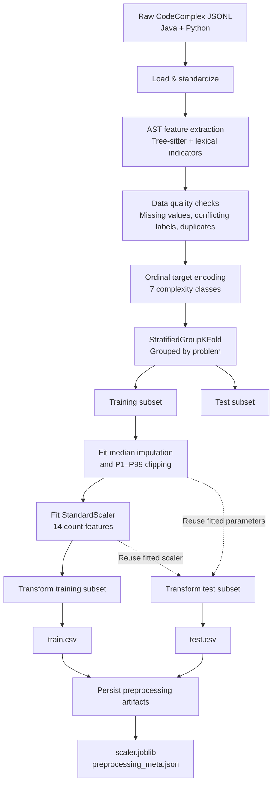
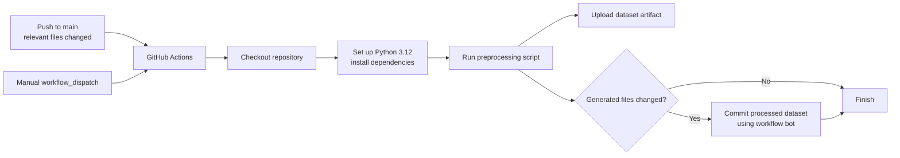

# BigOracle — Static Worst-Case Time Complexity Prediction

**BigOracle** is a machine learning project exploring the prediction of worst-case time complexity from source code using static structural features—without executing the program.

This repository establishes the project's **data engineering and preprocessing foundation**, including exploratory data analysis (EDA), AST-based feature extraction, a reproducible preprocessing pipeline, and automated dataset generation through GitHub Actions.

> **Project status:** Data preparation and preprocessing are implemented. Model training, experiment tracking, and deployment are planned next. Predictive performance has not yet been evaluated.

## Project Overview

| Component              | Description                                                         |
| ---------------------- | ------------------------------------------------------------------- |
| Prediction task        | 7-class worst-case time complexity classification                   |
| Input languages        | Java and Python                                                     |
| Dataset                | 9,800 CodeComplex samples across 300 programming problems           |
| Feature representation | 23 AST-derived and lexical features                                 |
| Parsing engine         | Tree-sitter                                                         |
| Data splitting         | Stratified, problem-grouped train/test split                        |
| Reproducibility        | Automated preprocessing, persisted transformation artifacts, and CI |

## Pipeline Architecture

The pipeline transforms raw source-code records into model-ready features. Solutions from the same programming problem are kept within the same data split to reduce evaluation leakage.



## Dataset

BigOracle uses [CodeComplex](https://github.com/sybaik1/CodeComplex), a dataset of Codeforces solutions annotated with worst-case time complexity. See the [original paper](https://arxiv.org/abs/2401.08719) for details.

| Property        | Value                                                             |
| --------------- | ----------------------------------------------------------------- |
| Languages       | Java (4,900), Python (4,900)                                      |
| Raw samples     | 9,800                                                             |
| Unique problems | 300 (258 represented in Java, 277 in Python, 235 shared)          |
| Raw fields      | `src`, `complexity`, `problem`, `from`, `tags`                    |
| Original labels | `constant`, `logn`, `linear`, `nlogn`, `quadratic`, `cubic`, `np` |

### Target Classes

The original labels are mapped to an ordered 7-class target:

| Class ID | Complexity | Class ID | Complexity            |
| -------: | ---------- | -------: | --------------------- |
|        0 | O(1)       |        4 | O(n²)                 |
|        1 | O(log n)   |        5 | O(n³)                 |
|        2 | O(n)       |        6 | NP-hard / exponential |
|        3 | O(n log n) |          |                       |

Raw dataset files are retained unmodified in `codecomplex_raw/`. Refer to the upstream repository for licensing and citation requirements.

## Static Feature Engineering

Each code snippet is parsed using [Tree-sitter](https://tree-sitter.github.io/) with Java and Python grammars. A single AST traversal extracts **23 model features**, supplemented by regex-based indicators of common algorithmic patterns.

| Feature group                  | Features                                                                                                     |
| ------------------------------ | ------------------------------------------------------------------------------------------------------------ |
| Code size                      | `loc`, `n_chars`, `ast_nodes`, `ast_depth`                                                                   |
| Loops                          | `loop_count`, `for_count`, `while_count`, `comprehension_count`, `max_loop_depth`                            |
| Branching                      | `branch_count`, `max_nesting_depth`                                                                          |
| Functions and recursion        | `func_count`, `call_count`, `max_recursive_calls`, `has_recursion`                                           |
| Algorithmic pattern indicators | `has_sort`, `has_halving`, `has_doubling`, `has_binary_search`, `has_heap`, `has_hash_container`, `has_memo` |
| Metadata                       | `is_java`                                                                                                    |

`parse_error` is calculated for auditing and data-quality analysis, but is excluded from the model feature set.

Language-specific handling includes:

- Python comprehensions are counted as loops.
- `else if` chains are handled without artificially increasing nesting depth.

### Why Static Analysis?

AST-based features provide a lightweight, execution-free representation of source code. They capture structural signals such as loop depth, nesting, recursion, and algorithmic constructs.

However, AST structure alone cannot fully represent variable dependencies, loop-bound semantics, or problem-specific input constraints. These limitations motivate further investigation into feature engineering and model design.

## Data Preprocessing

The exploratory notebook, `Eksperimen_BryanNoel.ipynb`, serves as the reference experiment. `automate_BryanNoel.py` implements the same operations in an automated pipeline.

Both are designed to produce byte-identical `train.csv`, `test.csv`, `scaler.joblib`, and `preprocessing_meta.json` artifacts.

| Step | Operation                        | Details                                                                                          |
| ---: | -------------------------------- | ------------------------------------------------------------------------------------------------ |
|    1 | Load and standardize             | Automatically identify source, label, language, and problem columns; map labels to seven classes |
|    2 | Extract features                 | 24 columns per sample: 23 model features + `parse_error`                                         |
|    3 | Handle missing data              | Remove empty source snippets and missing labels                                                  |
|    4 | Resolve duplicates and conflicts | Remove groups of whitespace-normalized identical code with conflicting labels, then deduplicate  |
|    5 | Encode target                    | Preserve complexity ordering rather than alphabetical ordering                                   |
|    6 | Split dataset                    | `StratifiedGroupKFold(5, shuffle=True, seed=42)`; first fold used as test, grouped by `problem`  |
|    7 | Impute and clip                  | Median imputation and P1–P99 clipping, fitted on training data only                              |
|    8 | Scale features                   | Fit `StandardScaler` on 14 count features using training data only                               |

### Engineering Decisions

**1. Problem-grouped splitting to reduce data leakage**

The 9,800 samples originate from only 300 problems—approximately 33 solutions per problem. A random row-level split could place solutions to the same problem in both training and test sets, allowing problem-specific patterns to inflate evaluation scores.

The pipeline therefore groups samples by `problem` and asserts that no problem appears in both subsets.

**2. Train-only fitting for preprocessing**

Imputation medians, clipping thresholds, and scaling parameters are learned exclusively from the training subset. Persisting these parameters enables consistent transformations during inference while preventing test-set statistics from leaking into training.

**3. Percentile clipping instead of IQR-based outlier detection**

Count features are concentrated around small values and zero. This often results in an interquartile range (IQR) of zero, causing many positive observations to be flagged as outliers. P1–P99 clipping provides a more practical alternative for this feature distribution.

## Reference Results

| Stage                       |              Samples |
| --------------------------- | -------------------: |
| Raw dataset                 |                9,800 |
| Removed: conflicting labels |                  133 |
| Removed: exact duplicates   |                  283 |
| After cleaning              |                9,384 |
| Training set                | 7,462 (246 problems) |
| Test set                    |  1,922 (54 problems) |

Exact split sizes may vary slightly across scikit-learn versions.

> **Evaluation caveat:** The held-out test set contains only 54 problems. Performance estimates from a single split may have substantial variance; grouped cross-validation is recommended for final evaluation.

## Repository Structure

```text
Eksperimen_SML_BryanNoel/
├── .github/
│   └── workflows/
│       └── preprocess.yml          # GitHub Actions preprocessing workflow
├── .workflow/
│   └── preprocess.yml              # Workflow copy retained for required layout
├── codecomplex_raw/
│   ├── java_data.jsonl             # Raw Java samples
│   └── python_data.jsonl            # Raw Python samples
└── preprocessing/
    ├── Eksperimen_BryanNoel.ipynb  # Exploratory experiment and reference pipeline
    ├── automate_BryanNoel.py       # Automated preprocessing entry point
    ├── requirements.txt
    └── codecomplex_preprocessing/
        ├── train.csv
        ├── test.csv
        ├── scaler.joblib
        └── preprocessing_meta.json
```

## Quick Start

**Requirements:** Python 3.10 or later. The CI workflow uses Python 3.12.

### 1. Set up the environment

Run from the repository root:

```bash
python3 -m venv .venv
source .venv/bin/activate
# Windows: .venv\Scripts\activate

pip install -r preprocessing/requirements.txt
```

### 2. Run preprocessing

```bash
python preprocessing/automate_BryanNoel.py
```

Or specify input/output paths and a seed:

```bash
python preprocessing/automate_BryanNoel.py \
    --raw codecomplex_raw \
    --out preprocessing/codecomplex_preprocessing \
    --seed 42
```

| Argument | Default                                                | Description                       |
| -------- | ------------------------------------------------------ | --------------------------------- |
| `--raw`  | `../codecomplex_raw` (relative to the script)          | Raw dataset directory             |
| `--out`  | `./codecomplex_preprocessing` (relative to the script) | Output directory                  |
| `--seed` | `42`                                                   | Random seed for grouped splitting |

### 3. Use the pipeline as a module

```python
from automate_BryanNoel import preprocess

X_train, X_test, y_train, y_test = preprocess(
    raw_dir,
    out_dir
)
# X: preprocessed features; y: class IDs 0–6
```

### 4. Run the experiment notebook

Open `preprocessing/Eksperimen_BryanNoel.ipynb`, select the `.venv` kernel, and run all cells from the `preprocessing/` directory.

### Generated Artifacts

Outputs are written to `preprocessing/codecomplex_preprocessing/`.

| Artifact                  | Description                                                                                |
| ------------------------- | ------------------------------------------------------------------------------------------ |
| `train.csv`, `test.csv`   | 23 transformed model features + `target`                                                   |
| `scaler.joblib`           | Fitted `StandardScaler` for count features                                                 |
| `preprocessing_meta.json` | Feature order, class mapping, imputation medians, clipping bounds, and split configuration |

## Continuous Integration

GitHub Actions automates dataset regeneration through `.github/workflows/preprocess.yml`.



| Configuration | Value                                                                                                                                  |
| ------------- | -------------------------------------------------------------------------------------------------------------------------------------- |
| Triggers      | Push to `main` affecting `codecomplex_raw/`, the preprocessing script, `requirements.txt`, or the workflow; manual `workflow_dispatch` |
| Runner        | `ubuntu-latest`, Python 3.12, pip cache                                                                                                |
| Steps         | Checkout, install dependencies, run preprocessing, upload artifact, commit changed outputs                                             |
| Outputs       | `codecomplex_preprocessing` artifact and—if generated data changes—a bot commit to `preprocessing/codecomplex_preprocessing/`          |

The workflow requires `contents: write`. If the commit step fails with HTTP 403, check **Settings → Actions → General → Workflow permissions** and enable **Read and write permissions**.

## Limitations

- Algorithmic-pattern indicators are lexical regex features and may produce false positives (for example, `/ 2` may be unrelated to binary search).
- Structural features do not capture variable dependencies or loop-bound semantics, limiting separation of classes that depend on input constraints.
- CodeComplex labels follow an annotation convention based on each problem's input variables; this information cannot always be recovered from source structure alone.
- The grouped test split contains 54 problems, so single-split estimates may be unstable. Grouped cross-validation is preferable for final evaluation.

## Roadmap

- [x] Exploratory notebook: data loading, EDA, and preprocessing
- [x] Automated preprocessing script
- [x] GitHub Actions workflow for processed dataset generation
- [ ] Train classification models and track experiments with MLflow (local, then DagsHub)
- [ ] Hyperparameter tuning
- [ ] CI retraining with MLflow Projects and Docker image publishing
- [ ] Model serving, monitoring, and alerting with Prometheus and Grafana
- [ ] C++ feature extractor with parity tests and benchmarks against the Python reference

## Dataset Citation

If you use CodeComplex, cite the original dataset paper:

```bibtex
@misc{baik2024codecomplex,
  title         = {CodeComplex: Dataset for Worst-Case Time Complexity Prediction},
  author        = {Seung-Yeop Baik and Joonghyuk Hahn and Jungin Kim and Mingi Jeon and Aditi and Yo-Sub Han and Sang-Ki Ko},
  year          = {2024},
  eprint        = {2401.08719},
  archivePrefix = {arXiv},
  primaryClass  = {cs.SE},
  url           = {https://arxiv.org/abs/2401.08719}
}
```

---

_BigOracle currently focuses on building a reproducible data foundation for static complexity prediction. Model development and empirical evaluation are future milestones._
